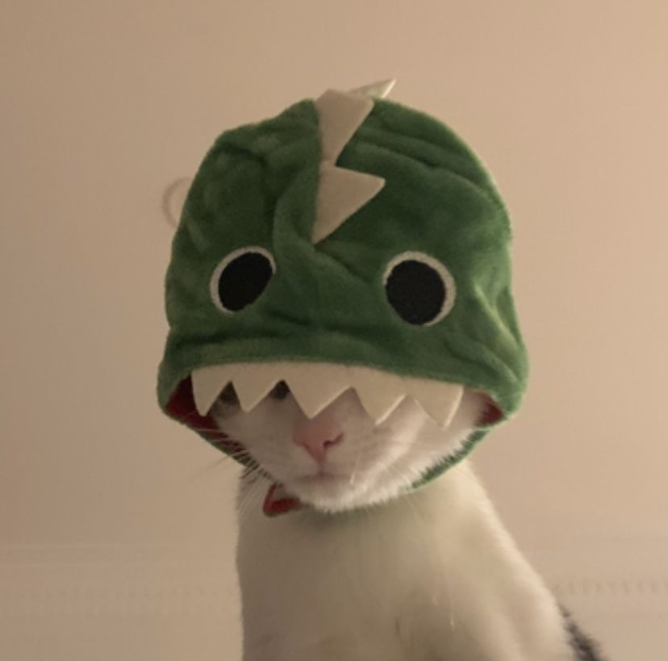

## Hi there 👋

# Introduction

I'm Nurul Izzani binti Ahmad Shayuri, a final-year Computer Science (Software Engineering) student at University Malaya.

I am interested in learning how software can be maintained, improved, and adapted to meet changing requirements. I hope this course will help me understand software maintenance practices and how to work with existing software systems.

- **Fun fact**: I enjoy listening to music and exploring new things in my free time. I am so in love with cats too!
- **Course expectations**: I hope to gain practical knowledge and hands-on experience in maintaining and evolving software.

<!--
**nurulizzani/nurulizzani** is a ✨ _special_ ✨ repository because its `README.md` (this file) appears on your GitHub profile.

Here are some ideas to get you started:

- 🔭 I’m currently working on ...
- 🌱 I’m currently learning ...
- 👯 I’m looking to collaborate on ...
- 🤔 I’m looking for help with ...
- 💬 Ask me about ...
- 📫 How to reach me: ...
- 😄 Pronouns: ...
- ⚡ Fun fact: ...
-->
